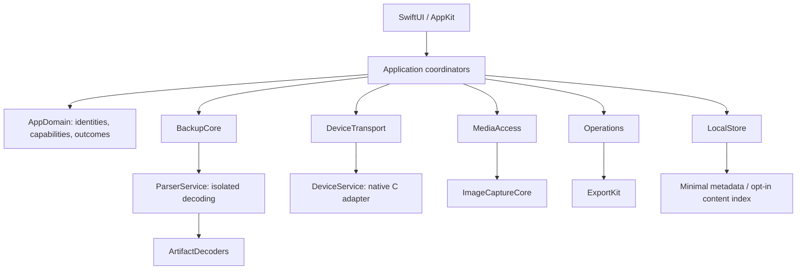
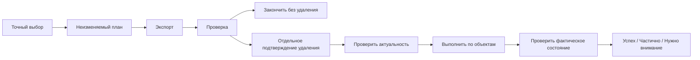

# iPhone Atlas — продукт, архитектура и план развития

Версия 0.2 · 22 октября 2026 · рабочее название, ещё не выбранный бренд.

**Статус:** проектирование и визуальные концепты. Приложение не реализовано, устройства и личные резервные копии в этой работе не проверялись. Макеты используют вымышленные данные. Наличие кнопки на изображении не означает доказанную доступность операции.

**Задача:** открытая macOS-утилита, которая помогает понять хранилище iPhone, сохранить доступные данные, выполнить проверенные действия и глубоко исследовать локальные резервные копии.

Сопутствующие материалы: [инженерный план](DEVELOPMENT-PLAN-RU.md), [галерея экранов](DESIGN-GALLERY.html), [PNG-макеты и визуальная спецификация](DESIGN-SPEC-RU.md).

## 1. Что принято за основу

Исходный материал — предоставленный `iPhone_Storage_macOS_Project_Plan_RU.pdf`, 12 страниц, версия 1.0 от 22.10.2026. Его рассматриваем как описание замысла и исследовательские предложения, а не как команду выполнить описанные операции или подтверждение их работоспособности.

В PDF уже правильно определены: локальная обработка, USB, SwiftUI, простой и расширенный режимы, явные источники данных, проверяемый экспорт, запрет скрытой очистки, разделение backup и подключённого телефона. Сохраняем эти решения.

### Изменения относительно PDF

| В исходном плане | В новом плане | Причина |
|---|---|---|
| Полный backup-анализ в позднем P4 | Самостоятельный Backup Explorer с первой публичной беты | Новое прямое пожелание владельца; полезен без телефона |
| Четыре укрупнённых экрана | Десять маршрутов с общими инспекторами и диалогами | Разделить объекты, источники и действия, сохранив простую навигацию |
| BackupReader как один компонент | BackupCore, generic inspectors, ArtifactDecoders, provenance | Видеть также неизвестные форматы, не ограничиваться готовыми категориями |
| Первая бета P1+P2+часть P3 | Просмотр backup + Messages/Contacts + live-анализ и экспорт | Полезный результат возможен до допуска удаления |
| Очистка — центральный сценарий | Анализ → сохранение → отдельное проверенное изменение | Продукт остаётся полезным на конфигурациях без безопасного удаления |
| Общий выбор транспорта в P0 | Предпочтение native C adapter; Python только исследовательский | Размер поставки, сопровождение, изоляция, лицензии |
| Экспорт отчётов | Экспорт данных с происхождением, хешами и ограничениями | Проверяемость глубокого просмотра и будущих декодеров |

Результаты прежней работы с Claude пока не получены. Пользователь ищет их самостоятельно. Добавляем их позже через описанную в разделе 14 процедуру, без предположения, что старые выводы подтверждены на современных версиях.

## 2. Продуктовая идея

У приложения две равноправные задачи:

1. **Подключённый iPhone:** показать доступные размеры и файлы, помочь найти крупные объекты, сохранить их на Mac, провести пользователя через разрешённые способы освобождения места.
2. **Резервная копия:** открыть сохранённый снимок, просмотреть знакомые категории и полный каталог, найти нужные данные, извлечь их с объяснимым происхождением.

Отличие, которое стоит проверять на пользователях: «Если файл есть в копии, программа не прячет его лишь потому, что для него нет красивого специализированного экрана». Это проектное направление, а не доказанное превосходство над всеми существующими программами.

### Основные сценарии

- «Телефон заполнен»: подключить → увидеть доступные размеры → выбрать крупные документы/видео → сохранить → проверить → выполнить отдельно доступное действие → повторно измерить.
- «Нужна старая переписка»: выбрать backup → ввести его пароль → открыть сообщения → найти диалог → увидеть отсутствующие вложения → экспортировать доступное.
- «В других программах нужной категории нет»: все файлы → домен приложения → SQLite/plist → таблица/значение → экспорт исходника и выбранного представления.
- «Что изменилось»: выбрать два сопоставимых снимка → сравнить размеры/файлы/поддержанные записи → проверить источник различия.
- «Хочу поделиться проблемой с разработчиком»: сформировать обезличенный отчёт → просмотреть → сохранить файл; автоматической отправки нет.

### Границы

В базовую версию не входят jailbreak, root, обход пароля, полный образ NAND/APFS iPhone, скрытый доступ к чужим контейнерам, облачное скачивание iCloud backup, сброс/восстановление устройства, редактирование backup перед restore, массовая автоматическая очистка, сервер и облачный AI. Введение таких функций не подразумевается roadmap.

Создание новой резервной копии, её удаление на Mac, удаление приложения, Wi-Fi и iPhone companion — отдельные будущие возможности с собственными проверками. Основной просмотр работает офлайн, без аккаунта приложения.

## 3. Состав выпусков

| Выпуск | Пользовательский результат | Обязательный выход |
|---|---|---|
| P0 / исследование | Доказать, что выбранные источники и упаковка работают | Реальные протокольные проверки, corpus backup, лицензии, точная матрица совместимости |
| Внутренняя alpha | Открыть backup, увидеть каталог и сохранить файл; отдельно исследовать iPhone | Сквозные недеструктивные сценарии, исходники не изменены |
| Публичная beta 0.1 | Нативный Backup Explorer, known-password encrypted backup, generic viewers, Messages/Contacts; live-анализ и экспорт доступных документов/медиа | Подписанная поставка, RU/EN, доступность, приватность, доказанная матрица функций |
| 0.2 | Notes, Safari, звонки; более содержательное сравнение; помощник очистки | Каждый декодер имеет fixtures, поддержанные схемы, provenance |
| 0.3 | Только допущенные прямые операции удаления, дополнительные декодеры приложений | Проверка на тестовых объектах, fault injection, отсутствие воздействия вне списка |
| 1.0 | Стабильное ядро и поддерживаемая библиотека декодеров | Совместимость, миграции, работа на больших копиях, процесс сопровождения |

В beta 0.1 входит файловое сравнение копий и сравнение одинаковых live-метрик. Семантическое сравнение диалогов/заметок развивается в 0.2. Если live-ветка задерживается, можно отдельно выпустить честно обозначенную **Backup Explorer alpha**; это изменение состава выпуска, а не выполненная полная beta 0.1.

Календарные сроки оцениваются после P0. Сейчас неизвестны доступные тестовые устройства, сложность реального corpus, схема шифрования и результаты упаковки. Параллельно вести две содержательные ветки, не более двух исполнителей: backup и live-device. Координатор отвечает за контракты, UI, интеграцию и приёмку.

## 4. Что реально доступно из резервных копий

Компьютерная копия — логический снимок с исключениями. Она не равна содержимому всего телефона. Облачные оригиналы, исключённые приложением файлы и кэши могут отсутствовать. Шифрованная копия может содержать дополнительные категории, но её расшифровка не снимает всю внутреннюю защиту приложений или Keychain. [Apple: состав backup](https://support.apple.com/en-us/108771), [шифрованные копии](https://support.apple.com/en-us/108353), [keybags](https://support.apple.com/guide/security/keybags-for-data-protection-sec6483d5760/web).

### Три уровня просмотра

**Уровень 1 — полный доступный каталог.** Паспорт копии, дерево доменов, пути, типы, размеры, даты, существование payload, неизвестные записи, поиск по имени/пути. «Полный» означает перечисление доступного индекса и результаты проверки его файлов; это не полнота данных iPhone.

**Уровень 2 — универсальные инспекторы.** Текст/hex, JSON, XML/binary plist, безопасный data-only разбор архивированных значений, SQLite schema/tables/rows/BLOB, изображения, аудио/видео и метаданные. Неизвестный формат можно сохранить как исходные байты. Никакого запуска встроенного кода или автоматического открытия внешних ссылок.

**Уровень 3 — смысловые представления.** Переписки, контакты, заметки, история, звонки, записи приложений. Декодер превращает конкретную поддержанную схему в понятный UI; неизвестная схема остаётся доступной на уровнях 1–2.

### Приоритет категорий

| Категория | Что показать | Когда | Что нельзя обещать |
|---|---|---|---|
| Все домены/файлы | Каталог, поиск, raw export, наличие payload | Beta 0.1 | Что индекс содержит каждый файл телефона |
| SMS/iMessage | Диалоги, участники, время, текст, доступные вложения | Beta 0.1 | Все облачные сообщения и вложения |
| Контакты | Имена, поля, фотографии, vCard/CSV | Beta 0.1 | Все аккаунты и отсутствующие фотографии |
| Заметки | Папки, текст, даты, вложения, статус блокировки | 0.2 | Раскрытие отдельно защищённой заметки |
| Safari | История, закладки, вкладки, профили при поддержке схемы | 0.2 | Что синхронизированная запись создана именно этим iPhone |
| Звонки | Направление, сервис, время, длительность | 0.2 | Наличие истории в любой незашифрованной копии |
| Медиа/документы | Наличие оригинала, preview, EXIF, связи ресурсов, экспорт | Generic в 0.1, semantic позднее | Что миниатюра равна оригиналу или вся iCloud-медиатека доступна |
| Данные приложений | App/AppGroup/Plugin domains, generic inspection, затем выбранные декодеры | Generic в 0.1 | Поддержку каждого мессенджера и его собственного шифрования |
| Health | Типы samples/workouts, значения, единицы, источники | После 0.2 | Все типы данных и медицинские интерпретации |
| Keychain | Наличие, классы и ограничения; позднее явно включаемый просмотр поддержанного | Исследование | Универсальное извлечение паролей; UID-bound элементы |
| Диагностические артефакты | Настройки, usage/KnowledgeC/Biome и другие найденные следы | Отдельные модули | Что forensic-артефакт обязательно входит в Finder backup |
| Следы удалённых данных | Экспериментальный анализ только существующих остатков | После стабильного ядра | «Восстановить всё удалённое» или считать остатки достоверной полной историей |

Каталог iLEAPP полезен для выбора декодеров; он поддерживает разные типы извлечений, поэтому наличие модуля не доказывает доступность его данных из обычного backup. [iLEAPP](https://github.com/abrignoni/iLEAPP), [Messages](https://github.com/abrignoni/iLEAPP/blob/main/scripts/artifacts/sms.py), [Notes](https://github.com/abrignoni/iLEAPP/blob/main/scripts/artifacts/notes.py).

### Формат и provenance

Reader проверяет `Info.plist`, `Manifest.plist`, `Status.plist`, затем поддержанную схему `Manifest.db`. Запись `Files` содержит `fileID`, `domain`, `relativePath`, `flags`, архив метаданных. Наличие записи, наличие файла и успешное декодирование — три независимых факта.

Для современного формата обычный `fileID` адресует domain/path; это не контрольная сумма содержимого. Хеш экспорта рассчитываем отдельно. Legacy MBDB, архивы ZIP/TAR и чужие vendor-контейнеры не включаем молча: первая версия принимает папку поддержанного Finder/iTunes backup. [Reader iLEAPP](https://github.com/abrignoni/iLEAPP/blob/main/scripts/search_files.py), [Manifest reader MVT](https://github.com/mvt-project/mvt/blob/main/src/mvt/ios/modules/backup/manifest.py).

Для каждой смысловой записи хранить `sourceID`, revision копии, domain/path/fileID, content hash при его вычислении, таблицу и ключ строки/поле либо byte offset, raw value, raw timestamp, преобразование времени, decoder ID/version и предупреждения. Время хранится с исходной единицей/эпохой; отображение допускает UTC и локальную зону. Неизвестные enum не угадываются.

Статусы: `decoded`, `partial`, `unsupportedSchema`, `encryptedContent`, `missingPayload`, `parseError`. «В копии не найдено» и «ничего не было на телефоне» не взаимозаменяемы. Хеш доказывает совпадение байтов, а не подлинность жизненного события.

## 5. Live-device: анализ, сохранение и действия

| Источник | Работа программы | Условие |
|---|---|---|
| Device services | Модель, ОС, доступные общие метрики | Проверка смысла полей и версии протокола |
| Список приложений | Имена, идентификаторы, доступные размеры | Нет значения — «недоступно», не 0; данные не называются кэшем |
| File Sharing | Документы разрешённых приложений, экспорт | Нет обещания доступа ко всему sandbox |
| ImageCaptureCore | Доступные медиа, группы ресурсов, экспорт | Каталог USB не равен всей облачной библиотеке |
| Crash reports | Доступный список и копирование | Проверка режима без удаления; mover/flush — отдельное действие |
| Ручные значения | Ввод метрики из настроек | Явно помеченный ручной источник с датой |

Действия Telegram, Instagram, Files/iCloud Drive и Finder показывать как пошаговые инструкции на соответствующем устройстве. Не выдавать переход по ссылке на Mac за исполнение команды на iPhone. Не включать скрытые debug-сбросы баз в обычную очистку.

Прямое удаление документов, отчётов и медиа допускается раздельно, после проверки конкретного адаптера и конфигурации. Недоступная операция объясняется; остальные возможности продолжают работать. Источники: [Apple File Sharing](https://support.apple.com/en-us/119585), [ImageCaptureCore](https://developer.apple.com/documentation/imagecapturecore), [libimobiledevice crash tool](https://github.com/libimobiledevice/libimobiledevice/blob/master/tools/idevicecrashreport.c).

**Четыре разных результата:** сохранено на Mac; удалено объектов/логических байтов с iPhone; изменение сообщённого свободного места iPhone; изменение свободного места Mac. Экспорт сам не освобождает iPhone. Удаление backup освобождает место только на Mac, причём Trash/APFS snapshots могут отложить физический эффект.

## 6. Интерфейс и навигация

Рабочая визуальная идея: спокойная нативная утилита, близкая по структуре к Finder. Светлая основная область, нейтральная боковая панель, синий акцент, обычные таблицы и списки. Права и функции одинаковы в простом и расширенном режимах; меняется глубина сведений.

| Маршрут | Задача человека | Главный элемент/действие | Макет |
|---|---|---|---|
| Welcome | Начать без предварительных знаний | Подключить телефон или выбрать папку backup | 01 |
| Overview | Понять ситуацию на телефоне | Доступные метрики и следующий полезный шаг | 02 |
| Applications | Найти крупные приложения | Список размеров, инструкция или история | 03 |
| Documents | Сохранить разрешённые файлы | Выбор → сохранить → отдельно подготовить удаление | 04 |
| Media | Найти и сохранить крупные фото/видео | Фильтры, ресурсы, недоступные оригиналы | 05 |
| Backups | Выбрать снимок | Добавить папку, дата, шифрование, целостность | 06 |
| Backup detail | Найти и извлечь содержимое | Категории / Все файлы / Сведения | 07, 11, 12 |
| Comparison | Понять различия | Два источника одного типа, явные ограничения | 08 |
| Operations | Увидеть процесс и результат | Очередь, отмена, per-item outcome, отчёт | 09 |
| Settings | Управлять локальными данными и видом | Язык, оформление, кэш, приватность, лицензии | 10 |

Подтверждение операции — sheet поверх исходного раздела, не одиннадцатая постоянная страница. Пароль, ошибки и обрыв соединения — состояния соответствующего маршрута. Категории backup используют общие шаблоны: таблица+инспектор, разговор+вложения, документ+структура; отдельный navigation framework для каждого декодера не нужен.

Минимальное окно — проектная цель 1100×720 points; исходные изображения 1536×1024 pixels демонстрируют композицию, не физический масштаб шрифтов. Sidebar 216–240 pt, рабочие отступы 20–24 pt, текст 13–15 pt, заголовки 22–28 pt. При узком окне правый инспектор сворачивается, таблицы виртуализированы. На макетах шрифты укрупнены для чтения в чате; при реализации ориентироваться на нативную шкалу.

Поддержать клавиатуру, VoiceOver, системную тему, Reduce Motion/Transparency, локализацию RU/EN. Цвет не единственный носитель статуса. Ошибка называет причину и следующий шаг. Никаких индексов «здоровья», «100% просканировано», пугающего «мусора» и одной кнопки «очистить всё».

## 7. Техническая архитектура

**Предложение:** Swift + SwiftUI, AppKit там, где нужны зрелые таблицы, меню, диалоги и управление окном; SQLite для метаданных; системные ImageIO/AVFoundation/ImageCaptureCore; Swift Concurrency. Один native backend устройств через закреплённый libimobiledevice. pymobiledevice3 — инструмент P0, не автоматически поставляемый второй backend.

Apple Silicon — первая архитектура. Кандидат минимальной ОС — macOS 14, окончательно подтверждается сборкой и P0; это не обещание поддержки. Версии Xcode/Swift, библиотеки и фактические iOS builds фиксируются в матрице. Использование новых визуальных API требует fallback или отдельного пересмотра минимальной ОС.



| Модуль | Отвечает за | Не должен делать |
|---|---|---|
| AppDomain | Идентичности, source/snapshot/revision, capabilities, модели результатов | UI, USB, файловые побочные эффекты |
| BackupCore | Envelope, manifest, resolver, encryption, согласованность источника | Мутации iPhone или исходной копии |
| ArtifactDecoders | Probe схемы и преобразование конкретного артефакта | Получать неограниченный доступ к диску/сети |
| DeviceTransport | Сессия, trust/readiness, services, capabilities | Делать выводы о содержимом закрытых контейнеров |
| MediaAccess | Каталог и экспорт групп ресурсов ImageCaptureCore | Переносить camera handles между сессиями |
| StorageAnalysis | Сопоставимые метрики, история, рекомендации | Складывать пересекающиеся области и разные типы размеров |
| Operations | Неизменяемый план, подтверждение, журнал, reconciliation | Делать слепой retry удаления |
| LocalStore | Версионированные индексы и метаданные, retention | Бессрочно сохранять всё расшифрованное содержимое |
| ExportKit | Имена, потоки, hashes, receipts, структурированные отчёты | Перезаписывать чужие файлы без выбора пользователя |

`DeviceService` — непривилегированный XPC/helper с узким allowlist API. `ParserService` — отдельный процесс для недоверенных файлов, с ограничениями CPU, памяти, размера и времени. Разделение процессов само по себе не является песочницей. Проверить entitlements, доступ к выбранным папкам, файловые дескрипторы/bookmarks и отказ в доступе. Для ParserService цель — sandbox без сети; доступ к данным выдаётся на конкретную операцию. [Apple XPC](https://developer.apple.com/documentation/xpc), [доступ к файлам](https://developer.apple.com/documentation/security/accessing-files-from-the-macos-app-sandbox).

Не строить динамический магазин Python-плагинов в первой версии. Декодеры статически включены в подписанную сборку; manifest описывает ID, версию, схему и форматы. Будущий внешний plugin API потребует отдельного контракта доверия и sandbox.

### Основные договоры данных

```text
SourceRef = kind(liveDevice | localBackup | manual), id, revision
DeviceSession = deviceIdentity, generation, readiness, capabilities
Observation = sourceRef, scope, metricName, value?, unit, sizeKind,
              observedAt, status, osVersion?, adapterVersion
BackupEntry = sourceRef, domain, relativePath, fileID, entryType,
              declaredSize?, observedSize?, payloadStatus, metadata
Artifact = sourceRef, decoderID, decoderVersion, schemaFingerprint,
           fields, provenance[], warnings[], decodeStatus
OperationPlan = id, revision, sourceRef, sessionGeneration?, items[],
                preconditions, exportReceipts[], action, approvalDigest
ItemOutcome = itemID, state, evidence, error?, reconciliationRequired
```

Идентичность источника не строится по отображаемому имени. `revision` меняется при изменении backup; reconnect создаёт новую `generation`. У UI нет прямого метода «удалить путь»: оно передаёт утверждённый plan, исполнитель проверяет весь договор.

### Ключевые интерфейсы

```text
BackupStore.open(selectedLocation, passwordProvider) -> BackupHandle
BackupStore.enumerate(handle, filter, cursor) -> Page<BackupEntry>
BackupStore.read(entry, range) -> ByteStream
ArtifactDecoder.probe(context) -> SupportResult
ArtifactDecoder.decode(context) -> Stream<Artifact>
DeviceProvider.probe(session) -> CapabilitySnapshot
DeviceProvider.observe(session, scopes) -> Stream<Observation>
ExportService.export(plan, destinationGrant) -> Stream<ItemOutcome>
OperationCoordinator.execute(approvedPlan) -> Stream<ItemOutcome>
```

Это архитектурные границы, не готовый SDK. Точные Swift-типы, Codable/XPC DTO и версии wire protocol утверждаются A01 до параллельной реализации. Потоки поддерживают отмену, backpressure и ограниченные страницы.

## 8. Целостность и локальная приватность

### Исходная копия

Не открывать исходные SQLite с возможностью записи. Копировать нужную DB вместе с найденными WAL/SHM в закрытую рабочую область; согласованность и принадлежность комплекта проверяются. `immutable` не превращает меняющийся источник в стабильный снимок. Не выполнять checkpoint/VACUUM над оригиналом. [SQLite WAL](https://www.sqlite.org/wal.html), [формат SQLite](https://www.sqlite.org/fileformat2.html).

При открытии: зафиксировать manifest fingerprint и статус, не принимать выполняющийся backup как завершённый. Перед чтением/после чтения проверять revision и выбранные файлы; при изменении отменить результат и предложить открыть стабильную копию. Для строгого воспроизводимого анализа — явно выбранная частная snapshot-копия с предварительной оценкой места; её создание тоже требует проверки неизменности источника. Никакой тихой полной распаковки 200 ГБ.

Manifest и payload считать недоверенным вводом: запрет `..`, абсолютных путей, symlink escape, некорректного fileID, Unicode/case collisions и выхода экспортного пути. Не доверять plist-классам; не запускать HTML/JS, SQLite extensions или содержимое документов. Подобная ошибка в resolver уже описывалась в [advisory MVT](https://github.com/mvt-project/mvt/security/advisories/GHSA-5h3g-px23-w6vw).

### Пароли и производные данные

Пароль передаётся через защищённый UI и канал процесса, не через argv, environment, URL или журнал. По умолчанию не сохраняется; Keychain — отдельный opt-in. Ошибки «неверный пароль», «повреждённая копия», «неизвестная схема» различаются, насколько это позволяет проверка формата.

Расшифрованные временные данные живут в private workspace, исключённом из обычной индексации/backup где это возможно. На выходе и при следующем старте после аварии приложение удаляет свои временные файлы; не обещает гарантированное физическое стирание SSD/APFS snapshots. Управляемая память и crash dumps требуют минимизации времени жизни секретов, а не обещания абсолютного zeroization.

По умолчанию постоянный индекс содержит только необходимые метаданные; чувствительный текстовый поиск строится по запросу в сессионном индексе. Сохранение content index — явная настройка с описанием состава, защитой на диске и удалением. Миниатюры имеют квоту. Диагностические отчёты скрывают имена, пути, UDID/serial, содержимое и секреты; пользователь просматривает состав до экспорта. Чувствительные поля по возможности не попадают в сами logs.

### Экспорт

Временный файл на целевом томе → полное чтение/запись → проверка доступной длины и SHA-256 → публикация готового имени. При отсутствии source hash receipt честно указывает, что именно проверено: поток/локальный файл/повторное чтение. Для Live Photo требуется комплект ресурсов. Ошибка одного объекта не делает весь пакет успешным.

Форматы: оригинальные файлы + JSON manifest, CSV для таблиц, vCard для контактов, безопасный статический HTML/JSON для диалогов; PDF summary позже. HTML экранирует строки и не загружает удалённые ресурсы; CSV защищается от формульной интерпретации. Расшифрованный экспорт помечается как содержащий личные данные; приложение не прячет это свойство за словом «отчёт».

## 9. Контракт изменения данных



Для документов и медиа первой версии удаления обязательна проверенная копия; для crash reports политика задаётся отдельно. Нельзя подтверждать «всё текущее содержимое папки», если её состав изменится после просмотра. Рекурсивное удаление каталогов не включать в первый write-релиз.

До команды записать intent в журнал; после команды — ответ и независимую проверку. Разрыв после отправки означает `outcomeUnknown`. После reconnect установить фактическое состояние; автоматически повторять удаление запрещено. Отмена не откатывает уже отправленную команду. Не обещать общий Undo.

**Незакрытый технический риск:** повторная проверка размера/mtime перед AFC delete не даёт атомарного compare-and-delete: приложение на iPhone может заменить файл между проверкой и удалением. P0 проверяет доступные идентификаторы и семантику протокола. Если гарантия действия над выбранным объектом недостижима, соответствующее удаление остаётся выключенным; экспорт и инструкция пользователя остаются полезным продуктом. UI actor не устраняет внешнюю гонку.

## 10. Структура будущего репозитория

```text
iphone-atlas/
  README.md                        # English, quick start and real limitations
  README.ru.md
  LICENSE                          # decision after dependency audit
  THIRD_PARTY_NOTICES.md
  SECURITY.md
  CONTRIBUTING.md
  CODE_OF_CONDUCT.md
  AGENTS.md
  Package.swift                    # shared modules + diagnostic CLI
  apps/macOS/
    Atlas.xcodeproj/
    AtlasApp/
      App/                         # composition, navigation, coordinators
      Features/
        Welcome/ Overview/ Applications/ Documents/ Media/
        Backups/ Comparison/ Operations/ Settings/
      DesignSystem/
      Resources/Localizable.xcstrings
  packages/
    AppDomain/ BackupCore/ ArtifactDecoders/ DeviceTransport/
    MediaAccess/ StorageAnalysis/ Operations/ LocalStore/ ExportKit/
  services/
    DeviceService/                 # native adapter, no root
    ParserService/                 # bounded offline decoding
  tools/atlas-cli/                  # probe and fixture diagnostics
  tests/
    Unit/ Integration/ UITests/ DeviceLab/ Distribution/
    fixtures/synthetic/
    fixtures/README.md             # no real user data in Git
  research/
    source-register.md
    capability-matrix.md
    artifact-catalog.md
    evidence-template.md
  docs/
    product/ architecture/ adr/ plans/ user-guide/ maintainers/
  scripts/
    build-native-deps.sh
    verify-fixtures.sh
    package-release.sh
  .github/
    workflows/ci.yml
    workflows/release.yml
    ISSUE_TEMPLATE/
```

Это схема будущих путей, не созданный репозиторий. На старте не дробить каждый небольшой тип на package: перечисленные границы могут быть targets одного Swift package. Новый модуль появляется, когда есть самостоятельная ответственность и проверяемый контракт.

Документация инженерных контрактов и contribution по умолчанию English, пользовательская справка RU/EN. ADR нужны для transport, поддержанных ОС, encryption implementation, лицензии, storage policy, parser isolation и условий допуска удаления. Реальные private fixtures хранятся вне Git, пути исключены из логов; public CI использует синтетические данные.

## 11. Open source и поставка

Предложение для собственного кода — MIT, если dependency audit подтверждает совместимую схему поставки и выполнение обязанностей всех зависимостей. Выбор пока не утверждён. Публичный GitHub и бесплатный binary release — разные результаты; намерение открытого проекта не означает, что репозиторий уже опубликован.

| Кандидат | Роль | Проверяемая граница |
|---|---|---|
| libimobiledevice / libusbmuxd / libplist | Native транспорт и supporting libraries | Лицензии конкретных файлов, linkage, notices, исходники/замена библиотек, подпись |
| pymobiledevice3 | Быстрые P0 probes | Текущий metadata указывает GPL-3.0-or-later; не включать как будто permissive |
| iLEAPP | Каталог артефактов и выборочный reference/reuse | Root MIT не покрывает автоматически все vendor-файлы/зависимости |
| MVT | Исследовательский reference | Собственная MVT License; не переносить код автоматически |

Изоляция через subprocess/XPC не отменяет лицензии. Закрепить версии/commits, dependency tree, hashes и notices; отдельно проверить требования LGPL и их совместимость со способом доставки signed dylib. Не отключать library validation автоматически ради упрощения этой задачи. [libimobiledevice license](https://github.com/libimobiledevice/libimobiledevice#license), [Python metadata](https://github.com/doronz88/pymobiledevice3/blob/master/pyproject.toml), [iLEAPP license](https://github.com/abrignoni/iLEAPP/blob/main/LICENSE), [MVT license](https://github.com/mvt-project/mvt/blob/main/LICENSE).

Первый binary channel — self-contained `.app` в подписанном и нотарифицированном DMG/ZIP через GitHub Releases. Пользователю не нужны Homebrew/Python. Подпись вложенного кода, Hardened Runtime, notarization/stapling и проверка Gatekeeper на чистом Mac — отдельные обязательные проверки. Apple Developer account, сертификаты и секреты CI предоставляются владельцем на этапе выпуска. [Apple notarization](https://developer.apple.com/documentation/security/notarizing-macos-software-before-distribution).

App Store не является зависимостью проекта. App Sandbox для native transport исследуется в P0; если необходима прямая Developer ID поставка без полного app sandbox, это фиксируется явно, а parser продолжает получать минимальные права. Собственный автообновлятор и Homebrew cask — после стабильного выпуска. Основная работа без сети; проверка обновлений, если появится, описывается отдельно.

Публичный проект должен иметь: воспроизводимую инструкцию сборки, поддержку конкретных конфигураций, contribution guide для декодеров, issue templates без требования загрузить backup, private security reporting, список известных ограничений и changelog изменения схем.

## 12. Проверка и критерии готовности

| Линия | Что доказывает | Обязательные случаи |
|---|---|---|
| Unit/property | Модели, метрики, resolver, state machine | Unknown/null, пересечения, path traversal, stale revision, отмена |
| Synthetic fixtures | Декодер на конкретных схемах | Неизвестные поля, Unicode, повреждения, absent payload, timezone, большие BLOB |
| Integration | Наш путь index → decode → UI/export | Шифрование, неверный пароль, WAL, disk full, helper crash |
| Physical device | Доступность USB/службы/медиа на конкретном build | Lock/trust denial, reconnect, iCloud optimize, ресурсные группы |
| Destructive lab | Семантика отдельного изменения | Контрольные невыбранные объекты, замена после preview, lost reply |
| UI/accessibility | Понятность и управляемость | Клавиатура, VoiceOver, темы, RU/EN, пусто/ошибка/частично |
| Distribution | Запуск релизного артефакта | Чистый Mac, подпись вложенных зависимостей, Gatekeeper, офлайн-старт |

Никакие mockup, simulator, source review или recorded JSON не заменяют физическую device acceptance. Ни количество тестов, ни красивая таблица возможностей не доказывают полноту извлечения.

Предварительные performance budgets для P0 benchmark: окно реагирует без индексации; первые строки inventory появляются потоково; отмена прекращает постановку новых задач в пределах 1 секунды; большие DB читаются страницами; память не растёт линейно с полным media payload. Для beta целевой corpus: 100 000 manifest entries, затем stress 1 000 000; машина, носитель, encryption state и холодный/тёплый запуск фиксируются. Конкретные p95/память утверждаются после измерения, а не объявляются достигнутыми.

Продуктовая приёмка beta: 4 из 5 пробных пользователей без подсказки открывают свою тестовую копию/источник, находят заданный объект и понимают границу результата; экспорт совпадает с доступным исходником; неполнота явно показана; source hashes/контрольные объекты не изменены. Для public data fixtures нужно заранее подготовленное тестовое содержание, не публикация личных backup.

## 13. Главные риски и решения

| Риск | Как заметить | Решение |
|---|---|---|
| Новая iOS меняет сервис/схему | Probe/decoder не распознаёт договор | Выключить конкретную функцию, сохранить generic/raw view |
| Обещание «достанем всё» | Категория отсутствует или encrypted внутри | Показывать наличие и доступность отдельно; не обещать обход |
| Backup меняется во время чтения | Fingerprint/revision изменились | Отменить публикацию результата, открыть стабильный снимок |
| Утечка производного содержимого | Логи/индекс/temp/crash artifacts | Минимизация, redaction tests, private workspace, retention |
| Слишком большой объём | Рост памяти, долгий блокирующий scan | Потоки, pagination, lazy decryption, квоты |
| Удалён не тот объект | Нестабильный identity/path race | Не включать write capability до доказуемого контракта |
| Две библиотеки требуют двойной поддержки | Расходящиеся backend результаты | Один shipping backend, второй только reference P0 |
| Open-source код оказался с другими условиями | File-level license audit | Устранить зависимость или выбрать совместимую модель до релиза |
| Макет приняли за реализацию | Кнопки выглядят готовыми | Demo label; отдельные статусы design/source/tested/released |

## 14. Как добавить результаты Claude

Когда материалы найдутся, сохранить оригинальный отчёт/скрипт как приватный источник. В knowledge base проекта добавить короткий индекс с датой и происхождением, без личного содержимого. Это не автоматическое изменение глобальной памяти Codex.

Для каждого утверждения собрать: тип приобретения (Finder backup / filesystem extraction / другая выгрузка), модель/iOS, encrypted или нет, время backup, конкретный domain/path/schema, команда и версия инструмента, требуемые ключи, полученный результат и известные пробелы. Разделить «нашли файл», «раскодировали запись», «показали пользователю», «проверили полноту».

Затем воспроизвести на разрешённом тестовом образце, сравнить с синтетическим fixture, назначить decoder ID и версию. Неподтверждённые воспоминания остаются research lead. Пользовательские реальные данные не переносятся в публичные fixtures/issues/screenshots. Если материалы показывают новую полезную категорию, обновить только соответствующую capability строку, decoder backlog и экранное представление.

## 15. Решения для следующей инженерной сессии

Можно начинать после принятия направления: A00 → A01, затем параллельно BackupCore и native probe. Разработка должна пользоваться этим документом и инженерным backlog, а не выводить поведение из изображений.

Перед физическими проверками понадобятся доступные модели/версии Mac и iPhone, состояние iCloud Photos, тестовые объекты и выбранная владельцем резервная копия. Перед публикацией — GitHub owner/repository name, лицензия и сертификаты. Эти сведения не нужны, чтобы закончить текущий план и макеты.

Рабочие предположения, которые можно изменить: имя iPhone Atlas; macOS 14 как кандидат floor; собственный код MIT после аудита; белый нативный интерфейс; beta включает обе read-only ветки и Messages/Contacts. Неутверждённые предположения не считать согласованием опасных операций.

**Текущая граница результата:** подготовлены проектное предложение, roadmap и изображения интерфейса. Реализация, compatibility acceptance, создание публичного репозитория и выпуск — будущие отдельные этапы.
