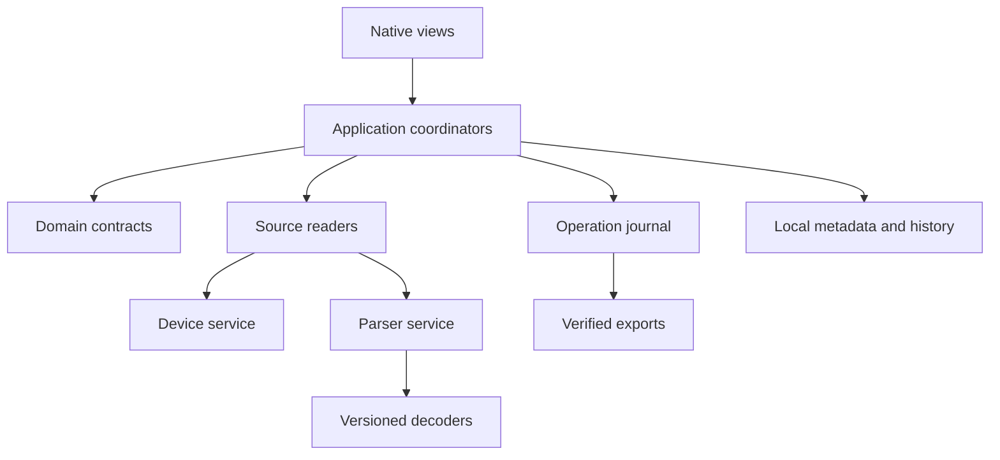

# iPhone Atlas — engineering architecture v0.3

Planning revision: 2026-10-23. Working name. This document specifies intended behavior; it is not evidence that an application, device adapter, decoder, or restore workflow has been implemented or tested.

## 1. Product boundary and the change from v0.2

Build a free, open-source, native macOS workspace for the owner's iPhone, applications, accessible files, local backups, imported archives, and evidence history. The long-term catalogue aims to cover the useful workflows represented by iMazing, 3uTools, coconutBattery, iExplorer, AnyTrans, iPhone Backup Extractor, and Finder/Apple Devices. The comparison is a discovery input, not a promise that every vendor claim can be reproduced through available interfaces.

The v0.2 foundations remain: a read-only live-device branch and a full accessible-backup catalogue; generic inspectors even when a semantic decoder is absent; local operation; RU/EN; verified exports; exact source and time; explicit admission of each write operation. The user's latest instruction expands the product roadmap, not the privileges of the current planning session. No connected-device mutation or private-backup inspection is authorized by this document itself.

| v0.2 commitment | v0.3 decision | Consequence |
| --- | --- | --- |
| Storage and accessible-file inspection | Full Device Passport, Apps Explorer, media, battery, diagnostics, history | More views share the same observation and capability contracts. |
| Full Backup Explorer from first beta | Preserved, including generic inspection, known-password encryption, Messages and Contacts baseline | Additional categories must not delay all-file access or silently replace the baseline. |
| Selected later app decoders | Versioned archive and artifact modules | Telegram/Meta imports and privacy reports remain distinct from current-device contents. |
| Backup creation and app management deferred | Admitted to the master roadmap as P3/P4 candidates | Their implementation requires fresh evidence and operation-specific gates. |
| Restore and firmware outside the adopted implementation scope | Conditional research track | A visible roadmap entry does not enable a device command. |
| No required account/server/cloud AI | Preserved for the local product | Optional online lookups and companion capabilities cannot block offline work. |
| macOS first | Preserved; portable domain and file formats | Windows/Linux interfaces are later projects, not implied by portable dependencies. |

“Free” means no feature, export, device-count, or time-limit paywall in released Atlas functionality. It does not imply that all desired functions are possible, or that maintaining signed releases has no cost. See [FREE-OPEN-SOURCE-POLICY.md](FREE-OPEN-SOURCE-POLICY.md).

## 2. Delivery phases and release naming

Planning version **v0.3** is independent of the future application's semantic version. Use phase labels until release criteria are met; do not label a set of mockups an app beta.

| Phase | Deliverable | Admission rule |
| --- | --- | --- |
| P0 | Reproducible fixture-based vertical slice; dependency and transport feasibility evidence | A developer can build the shell, open a synthetic backup, inspect an entry, and export matching bytes. |
| P1 | Read-only core: real supported backups, known-password encrypted backups, generic viewers, baseline Messages/Contacts, device/apps overview, exposed documents, supported media export | Every shipped capability has a configuration-specific test record. The full public beta retains the v0.2 baseline. |
| P2 | Richer decoders, privacy/account-archive imports, history, comparison, richer media and diagnostics | Schema versions, missing-data behavior, attribution, and export fidelity are demonstrated per module. |
| P3 | Validated management: new backups, approved writes, selected app management, scheduling and automation | Each command has an immutable plan, scoped approval, failure/recovery evidence, and post-action verification. |
| P4 | Conditional companion, developer-service, cloud, managed-device, migration, firmware and mirroring work | The exact acquisition route, distribution permission, versions, and recoverability are established first. |
| PARKED | Desired outcomes without a justified route | Keep the request and reason visible; do not implement a misleading enabled button. |

An earlier **Backup Explorer development preview** may ship before the full P1 beta, provided its name and published scope are explicit. No date or total engineering estimate is defensible before the first transport, encrypted-backup, and schema experiments.

## 3. Runtime architecture

Use Swift and Swift Concurrency for first-party application code; SwiftUI for navigation and most views; AppKit where tables, menus, windows, and inspectors need it. Use system SQLite and Apple media frameworks when they meet the contract. The initial native-device candidate is a pinned libimobiledevice adapter. Keep pymobiledevice3 in a research environment until a separate packaging, licensing, and maintenance decision admits it. Do not accidentally ship two acquisition stacks.

Apple Silicon is the first target. macOS 14 is a candidate deployment floor from the prior plan, not a verified compatibility promise. Record actual Xcode/Swift/SDK/architecture combinations before adoption; newer APIs need fallbacks or an explicit floor change. The coordinator's 2026-10-23 Mac probe found Swift 6.3.3 in Command Line Tools and an `arm64-apple-macosx26.0` target, but `xcodebuild` could not use a full Xcode installation because the active developer directory was `/Library/Developer/CommandLineTools`. Refresh this state at coding start. Package/core work can proceed with the available toolchain; a complete app-bundle, UI, signing and distribution check remains a separate gate. Do not change the global developer directory or install Xcode silently.

These are responsibility boundaries, not a requirement to create every package before the first user scenario works.

| Proposed module/path | Owns | Boundary |
| --- | --- | --- |
| `packages/AppDomain/` | Identities, observations, capabilities, evidence, plans, outcomes | No UI, network, USB, or file writes. |
| `packages/BackupCore/` | Envelope, manifest, payload resolver, supported decryption | Never edits the source backup or calls a device restore service. |
| `packages/ArtifactDecoders/` | Schema probes, data-only decoding, semantic artifacts | Receives bounded inputs; cannot discover arbitrary host files. |
| `packages/DeviceTransport/` | Session lifecycle, native service adapters | No generic “run command” or arbitrary service passthrough in UI/XPC API. |
| `packages/MediaAccess/` | ImageCaptureCore catalogue and resource groups | Handles bound to the correct device/session generation. |
| `packages/ImportKit/` | Explicitly selected privacy/account archives | No login scraping; account exports remain account sources. |
| `packages/StorageAnalysis/` | Comparable metrics, non-overlapping aggregation, deltas | Unknown is not zero, cache, or deletion. |
| `packages/Operations/` | Plan validation, consent binding, durable per-item outcomes | No blind retry of mutations or generic rollback promise. |
| `packages/ExportKit/` | File naming, streaming, hashing, receipts, report encoders | No destination overwrite without selected policy. |
| `packages/LocalStore/` | Source catalogue, schema migration, bounded caches/history | Content indexing and secret retention require explicit settings. |
| `apps/macOS/` | Native shell, routes, inspector, accessibility, localization | Renders capability state; cannot override executor gates. |
| `services/DeviceService/` | Unprivileged XPC boundary for admitted device actions | A narrow typed allowlist, no root helper in the baseline. |
| `services/ParserService/` | Isolated processing of untrusted files | Demonstrated sandbox and limits; process separation alone is insufficient. |
| `tools/atlas-cli/` | Repeatable diagnostics using the same core | No second business-logic implementation. |
| `tests/fixtures/synthetic/` | Generated backups, archives, responses and expected results | No real personal data or unlicensed competitor assets. |

## 4. Contracts before parallel implementation

Keep stable identifiers separate from display names. Use explicit versions in persisted/wire data, additive decoding where safe, and migrations for incompatible changes. The notation below is a specification, not compile-ready Swift.

### Sources and identities

`SourceRef` contains `sourceID`, `kind`, `revision`, `capturedAt`, `ingestedAt`, `coverageInterval?`, `ownerScope`, `adapterID`, `adapterVersion`, and `originEvidenceRef`. Source kinds include `liveDevice`, `localBackup`, `appPrivacyReport`, `accountArchive`, `manualObservation`, `publicCatalogue`, and a future `companionExport`.

`DeviceIdentity` is an internal stable ID with separately protected external identifiers. `DeviceSession` adds a monotonically changing `generation`, connection kind, readiness, and probe time. Reconnection creates a new generation even for the same device. Device name is never an identity key.

`AppIdentity` uses bundle identifier plus installation context when known. An association between an app, a backup domain, an app group, and a store listing has its own evidence and uncertainty. Shared app-group bytes belong to a shared scope; they are not added in full to each application.

### Separate product maturity from runtime availability

`FeatureMaturity = planned | sourceDocumented | sourceInspected | fixtureVerified | deviceLabVerified | releaseVerified`.

`CapabilityState = available | partial | requiresUserAction | unavailable | unsupported | unknown | failed`.

`CapabilitySnapshot` binds a capability ID and action class to source/session, OS build, device model where relevant, adapter revision, prerequisites, scope, probe time, test-evidence IDs, and reason codes. `sourceDocumented` never promotes a feature to `available` on the current phone. A lab result for one build does not establish universal support.

### Observations and interpretation

`Observation` carries the source reference, object/scope identity, metric key, raw value and raw unit, normalized value and unit, size/count semantics, observed time, status, interpretation version, derivation inputs, and quality notes.

`ValueStatus = observed | notReturned | notCollected | notPresentInSource | unavailable | unsupported | invalid`.

Use an optional value with a reason instead of a sentinel zero. Preserve enough raw returned data for Advanced inspection, with redaction rules on diagnostics. Distinguish:

- charge percentage, raw battery-capacity estimate, cycle count, and a user-recorded official Battery Health value;
- current app binary/data estimates, selected-backup payload bytes, and account-archive bytes;
- bytes enumerated, bytes successfully read, and bytes verified after export;
- known records absent in a selected snapshot from records deleted on the physical device.

A derived metric stores its formula/version and references its inputs. Do not label `DynamicDiskUsage` as cache, or unexplained device storage as recoverable waste.

### Coverage and comparison

`Coverage` describes the enumerated scope, exclusions, payload availability, collection interval, decoder/schema support, and known gaps. It has no invented “percentage of the whole phone” denominator.

`ComparisonKey` includes device/source kind, metric definition, unit/size semantics, adapter interpretation version, filter/scope, and applicable installation state. Only comparable rows receive a numeric delta. Mixed backup/live/account sources can appear side by side with an explanation, not as a single reconciled total. Overlapping privacy-report intervals require deduplication or an explicit overlap status.

### Backup, artifacts, and outcomes

`BackupEntry` includes source revision, domain, relative path, file ID, entry type, declared/observed sizes, metadata, and payload status. A backup file ID is an addressing identifier, not a content-integrity hash.

`Artifact` contains decoder ID/version, schema fingerprint, fields, field-level evidence, raw input references, missing-resource references, and decode status. Unknown schema falls back to the generic catalogue and inspectors.

`OperationPlan` contains action ID, immutable revision, source/session binding, exact object IDs, expected versions/hashes where meaningful, destination grant, collision policy, preconditions, estimated impact, export prerequisites, and approval digest. `ItemOutcome` records each item independently with state, bytes, validation method, errors, and reconciliation requirement.

## 5. Source acquisition rules

**Existing backups:** accept a user-selected supported folder first. Detect complete/incomplete/unsupported envelopes and stable revisions. Do not imply support for arbitrary ZIP/TAR/vendor backup containers just because a file chooser accepts them. Computer backups have documented exclusions and do not represent all phone or cloud content [S1].

**Live device:** keep discovery, pairing/trust, lock state, and service readiness visible. Start with normal trusted-device services; developer services have a separate capability category. Do not replace or reconfigure the Mac's system usbmuxd as a routine onboarding step. Source-review each native command for hidden device-side writes, including diagnostic/crash-report movers.

**File Sharing:** expose only the app's participating document scope. The user's ability to copy these files does not establish access to its full private container [S2].

**Media:** verify device identity mapping and resource groups, including paired still/video resources. Distinguish original, derivative, thumbnail, placeholder, and unavailable cloud-backed resource. An export success is not evidence that phone space was freed.

**Privacy/archive imports:** begin with bounded, offline parsing of owner-selected files. Retain original schema, source interval, attribution, unknown fields, and import warnings. Do not turn a contacted domain into a malware allegation, or an account archive into proof of activity on one particular phone.

**Conditional integrations:** Screen Time companion, Account Data Transfer, mirroring, firmware, developer tools, managed-device inventory, and app download/restore routes each need an ADR and feasibility artifact. Apple approval or entitlement-dependent functions must be tested under intended distribution conditions. A development experiment or vendor demonstration does not satisfy that gate.

## 6. Source preservation and parser boundaries

Open source databases without modifying them. When a consistent private working copy is needed, consider DB/WAL/SHM together, confirm their relationship, and record the source revision. Do not checkpoint or vacuum the original. SQLite's `immutable` setting does not create a snapshot of a changing source [S3].

Resolve every manifest/archive path inside its granted root. Reject traversal, absolute paths, symlink escapes, invalid identifiers, and ambiguous Unicode/case collisions. Stream and paginate large inputs; enforce byte, row, nesting, decompression-ratio, time, and memory budgets. Do not instantiate arbitrary plist/archive classes, execute SQLite extensions, run embedded scripts, or fetch remote preview resources.

ParserService should receive narrow file descriptors or scoped grants for a specific job and have no network access. Validate entitlements and denial behavior in the actual app bundle. Start with the smallest process arrangement that proves this boundary; documentation alone does not make a parser sandboxed. Decoders in initial releases are built into the signed app, not downloaded executable plugins.

Known backup passwords enter through protected UI and a scoped IPC channel, never shell arguments, environment variables, URLs, or logs. Default retention is the current session; Keychain storage is opt-in. Use short-lived private plaintext workspaces, quota limits, crash cleanup, and explicit local-data controls. Do not promise physical erasure of SSD blocks or APFS snapshots.

LocalStore retains minimal metadata by default. Persistent message text indexes and thumbnails have separate opt-in/retention controls. Diagnostic exports show a preview and redact identifiers, paths, message content, and secrets by default; reporting never uploads automatically.

## 7. Operations, cancellation, and recovery

An operation has a state machine: `draft → preflighted → awaitingApproval → approved → executing → verifying → completed/partiallyCompleted/failed/cancelled/reconciliationRequired`. Read-only browsing does not need a mutation-style confirmation. Destination selection and ordinary export are user actions; destructive device commands require a separate, concrete review.

The executor revalidates the immutable plan, exact objects, capabilities, revision, session generation, and consent digest immediately before acting. Changing selection invalidates approval. A late callback from an old device session cannot update a new operation.

Exports stage data on the destination volume, verify the available length and SHA-256, then publish the final filename. The receipt says whether verification compared source bytes, a stream hash, a destination reread, or an independently available source hash. A transfer-completed flag is not the same as verified equality. File name collision policy is explicit. Failed items remain visible and never inflate the successful total.

Cancellation stops admission of new work and requests interruption where the adapter supports it. Already completed irreversible actions remain completed; cancellation is not rollback. A disconnected mutation becomes `reconciliationRequired` until the target is re-identified and its state is checked. Retry reads within limits; resume exports only with proven source identity; never blindly repeat delete, install, restore, or firmware commands.

Backup creation writes a new host backup and may change device-side state; treat it as an admitted management operation, not as passive browsing. Host backup retention/deletion has its own exact path list and protected source policy. Full restore, per-app restore, migration, firmware, and location simulation each require a dedicated operation model and tested failure procedure. There is no generic “undo” for them.

## 8. Narrow first coding slice

Build only enough native code to demonstrate this path with synthetic data:

1. Launch the macOS shell with a clear demo/source indicator.
2. Select a generated, unencrypted backup fixture with a small valid manifest and several payload types.
3. Show domains and all manifest entries, including unknown and missing payloads.
4. Select an entry; show metadata, source/time, coverage, and bounded text/hex preview.
5. Export one selected payload to a chosen temporary destination; produce a JSON receipt and verify bytes.
6. Cancel a larger synthetic export, and prove source bytes and manifest did not change.

Use the same AppDomain contracts intended for real sources. No USB backend, companion, real-user backup, cloud account, mutation button, or firmware workflow is necessary for this milestone. Do not scaffold dozens of empty packages to simulate completion. Keep `B01a` and `O01a` intentionally smaller than their full P1 tasks.

Start with Swift packages for AppDomain, the fixture reader and exporter so the available Command Line Tools can make progress. Add the minimal native shell target when the SDK/toolchain supports it. If the full UI build is blocked by Xcode availability, demonstrate the same source/inspect/export path through a thin CLI over the shared modules, record the blocker, and do not call the native UI milestone complete. Keep the editable prototype as a design reference, not as a substitute for native implementation.

The useful proof is a clean build plus a captured complete scenario, fixture generator inputs, exact validation commands/results, source/output hashes, and a short checkpoint. Afterwards, implement the real backup path and native-device probe in parallel behind the accepted contracts.

## 9. Verification and compatibility records

Tests target behavior with material consequences: parser bounds, missing payloads, source immutability, path escapes, schema fallback, identity/reconnect, duplicate counting, export verification, cancellation, and mutation preconditions. Do not multiply UI snapshot tests for cosmetic edits or mark fixtures as real-device evidence.

Maintain a machine-readable compatibility record containing feature/action ID, device model, OS version/build, host/toolchain, adapter commit, transport, permissions, source/fixture ID, result, expected limitation, test date, and evidence path. Store failed and unavailable outcomes as carefully as passing ones.

For each release: test the actual signed bundle on a clean target environment; check helper sandboxing, permissions, library loading, RU/EN, keyboard/VoiceOver, large-source behavior, and offline behavior. Publish only the supported matrix. No auto-download of executables, trust reconfiguration, daemon installation, or personal-data upload belongs in a “repair connection” convenience button.

## 10. Primary references and inherited research

These architectural decisions build on the source registers in `research/2026-10-23/DEVICE-RESEARCH.md` and `APPLICATIONS-RESEARCH.md` on the Mac project. New implementation work must pin revisions rather than depending on moving `master` branches. References describe mechanisms; no lab success is claimed here.

- **S1** Apple, backup methods and exclusions: https://support.apple.com/en-us/108771 ; encrypted backups: https://support.apple.com/en-us/108353 .
- **S2** Apple, File Sharing: https://support.apple.com/en-us/119585 .
- **S3** SQLite, WAL behavior: https://www.sqlite.org/wal.html ; URI `immutable`: https://www.sqlite.org/uri.html .
- **S4** Apple, XPC: https://developer.apple.com/documentation/xpc ; sandbox file access: https://developer.apple.com/documentation/security/accessing-files-from-the-macos-app-sandbox .
- **S5** libimobiledevice source and utility catalogue: https://github.com/libimobiledevice/libimobiledevice .
- **S6** ideviceinstaller current manual, including legacy limitations: https://github.com/libimobiledevice/ideviceinstaller/blob/master/man/ideviceinstaller.1 .
- **S7** Apple, App Privacy Report: https://support.apple.com/en-us/102188 ; data format: https://developer.apple.com/documentation/network/inspecting-app-activity-data .

The v0.3 plan does not overwrite historical research or convert earlier research tasks into completed implementation work.
